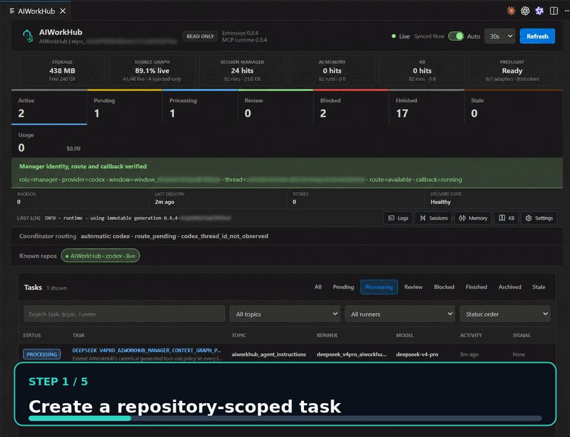
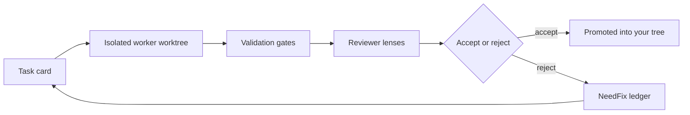

# AIWorkHub

<div align="center">
  
</div>

<p align="center">
  <strong>An AI manager that runs Claude Code, Codex and Copilot as its workers.</strong><br>
  An open-source control plane for multi-model AI coding agents: it splits a large project into work cards, sends each card to the cheapest model that can do it, reviews every change against tests before it lands in your tree — and it is building AIWorkHub itself.
</p>

**Proof, from this repository's own history:**

- 1,984 commits since 2026-07-20, written through its own task loop
- 347 work cards accepted into its own tree
- 651 times a worker's change was sent back with code-level findings
- 621 independent reviewer passes
- 620 test files, about 262k lines of Python

**What makes it different:**

- Semantic edit: workers change hash-verified line ranges, never rewrite whole files.
- Review loop: mechanical gates and tests run first, then an independent reviewer reads the code; the manager accepts, returns with findings, or blocks — the same turn.

<p align="center">
  <a href="https://github.com/shrec/AIWorkHub/actions/workflows/ci.yml"></a>
  <a href="https://shrec.github.io/AIWorkHub/"></a>
  <a href="https://github.com/shrec/AIWorkHub/releases"></a>
  <a href="LICENSE"></a>
  
  
  <a href="https://glama.ai/mcp/servers/shrec/AIWorkHub"></a>
  <a href="https://lobehub.com/mcp/shrec-aiworkhub"></a>
</p>

<p align="center">
  <a href="https://glama.ai/mcp/servers/shrec/AIWorkHub"></a>
  <a href="https://lobehub.com/mcp/shrec-aiworkhub"></a>
</p>

<!-- mcp-name: io.github.shrec/aiworkhub -->



## What AIWorkHub is

AIWorkHub is a VS Code extension and an MCP server. You talk to one **manager**
AI. It splits your goal into **task cards** and hands each card to a **worker**
AI (Codex, Claude, Copilot-hosted models, DeepSeek, GLM and others). Nothing
lands in your tree until independent review and measured validation accept it.

Every repository owns its own `.aiworkhub/` state. There is no AIWorkHub cloud
account, and the MCP server speaks stdio only.

## How it works



1. **Card.** The manager writes a bounded card: objective, acceptance criteria,
   dependencies, allowed writes and validation.
2. **Isolated worker.** A worker runs the exact card in its own worktree, with
   Source Graph and repository context. It never finalizes its own work.
3. **Validation gates.** Mechanical checks and the card's declared tests run
   first.
4. **Reviewer lenses.** Independent correctness, security and code-quality
   reviewers read the candidate. One aggregate decision packet reaches the
   manager.
5. **Accept or reject.** The manager promotes verified work, or rejects it with
   exact residual work.
6. **NeedFix ledger.** Findings are tracked as NeedFix records until a verified
   fix resolves them.

## Key features

- **Multi-provider workforce routing.** Cards are routed to models by cost and
  observed outcome: premium models for hard judgment and review, cheaper capable
  models for bounded work.
- **Source Graph.** A repository-local, incrementally refreshed code index
  (including Dart) that gives managers and workers bounded symbol, call, test and
  impact queries instead of broad file scans, across exactly 38 Source Graph
  query modes. The exact-target modes are `file`, `function`, `class`, `body`,
  `bodygrep` and `deps`. Workers change hash-verified line ranges through
  semantic edit, not whole-file rewrites. See the full-resolution
  <a href="site/assets/aiworkhub-source-graph-architecture.svg">Source Graph architecture diagram</a>
  for the complete index and query pipeline.
- **Sandboxed workers.** Worker processes run inside a Windows AppContainer or a
  Linux Landlock sandbox with explicit write scopes.
- **NeedFix on the dashboard.** The dashboard groups NeedFix records by work
  state, so open, in-progress and finished work are visible at a glance.
- **Callback loop.** When a worker reaches review, a durable callback wakes the
  verified manager chat. A callback is a wake-up, not an approval.
- **Release cut.** `scripts/release_cut.py` runs a release as one ordered run
  (version, changelog and README checks, host suite, VSIX package, release commit,
  receipt, tag) and stops at the first failing step.
- **Context that persists.** Session Manager, AI Memory and KB are
  repository-scoped and available to managers and workers.

## Install and quick start

### VS Code

1. Install **AIWorkHub** from the
   [VS Code Marketplace](https://marketplace.visualstudio.com/search?term=AIWorkHub&target=VSCode),
   or download the VSIX from the latest
   [GitHub release](https://github.com/shrec/AIWorkHub/releases) and run
   `code --install-extension ./aiworkhub-<version>.vsix`.
2. Open a Git repository and run **AIWorkHub: Open Dashboard**.
3. Choose **Initialize AIWorkHub** once. It is explicit and idempotent: it
   creates `.aiworkhub/` and starts the first Source Graph index.
4. Open a **new** Codex, Claude or other MCP-capable chat after initializing, so
   the chat discovers the repository's MCP tools.
5. Describe the outcome you want. The manager creates cards and launches
   workers; you inspect the evidence in **Review** and accept or reject.

The built-in dashboard **Manager** chat and Claude Code are woken automatically
when a worker finishes. A Codex sidebar chat is inbox-only and polls the review
queue itself; see [Callback delivery](docs/CALLBACKS.md#manager-transports).

### Any MCP client

AIWorkHub speaks MCP over stdio, so any MCP client can run it against a
repository.

**Option A: uvx.** Add the server to your client's MCP configuration (until the PyPI package is published, use the release wheel: `"args": ["--from", "/path/to/aiworkhub-<version>-py3-none-any.whl", "aiworkhub"]`):

```json
{
  "mcpServers": {
    "aiworkhub": {
      "command": "uvx",
      "args": ["aiworkhub"],
      "env": {
        "AIWORKHUB_REPO_ROOT": "/path/to/your/repo"
      }
    }
  }
}
```

**Option B: Docker.** Build the image from an AIWorkHub checkout, then run it
from the repository you want managed:

```bash
docker build -t aiworkhub-mcp .
docker run -i --rm -v "$PWD:/workspace/repo" aiworkhub-mcp
```

The image defaults to `AIWORKHUB_REPO_ROOT=/workspace/repo` with writes and
launches off.

Writes and worker launches are off by default. Enable them only in a trusted
manager process with `AIWORKHUB_ALLOW_WRITES=1` and `AIWORKHUB_ALLOW_LAUNCH=1`.
`AIWORKHUB_MAX_PROCESSES` caps concurrent workers. Launched workers never
inherit the manager's launch capability.

## Requirements

- VS Code 1.93 or newer for the extension.
- Python 3.12 or newer for the MCP runtime (the extension packages its own).
- At least one authenticated model route: an editor Language Model provider or a
  logged-in Codex or Claude Code CLI. AIWorkHub does not copy or proxy
  credentials. The Dashboard's Preflight shows which routes are ready.
- Linux, macOS, native Windows, WSL and Remote-SSH are supported; Linux is the
  canonical development and validation host.

## Measured claims and limits

- **semantic-edit-historical-cap-boundary**: historical capped a/b observation at 20k/200k ops shows a 29.329% reduction; this is a capped historical sample, not eligible as a live guarantee.
- **context-bundle-v2-structural-only**: structural-only validation; live fleet remeasurement pending.

## What's new in 0.12.98

- Workers see only what a card allows: Linux read roots through Landlock, a `deny_read` glob list enforced on Landlock and Windows AppContainer, an optional one-time `workspace_prepare` hook per worktree, and a visibility receipt in the review packet.
- A hub host validation stage runs a card's host commands and test sweep on a full candidate tree in the background before accept, and the manager can amend a pending card or accept with a small correction of confirmed findings.
- The full release history is in [CHANGELOG.md](CHANGELOG.md).

## Documentation

| Guide | Covers |
| --- | --- |
| [Getting Started](docs/GETTING_STARTED.md) | First run, manager prompts, Remote-SSH, recovery |
| [Architecture](docs/ARCHITECTURE.md) | The whole system and its control loop |
| [Source Graph](docs/SOURCE_GRAPH.md) | Index, query modes and semantic edit |
| [Manager Context Graph](docs/CONTEXT_GRAPH.md) | Opt-in manager conversation evidence |
| [Callbacks](docs/CALLBACKS.md) | Callback delivery per client |
| [Benchmarks](docs/BENCHMARKS.md) | Measured benefits and their limits |
| [Publishing](docs/PUBLISHING.md) | Release channels and owner setup |
| [Roadmap](docs/PRODUCT_ROADMAP.md) | Where the product is going |

Also: [Security policy](SECURITY.md), [Contributing](CONTRIBUTING.md),
[Product site](https://shrec.github.io/AIWorkHub/).

## Development

```bash
python -m pip install -e ".[dev]"
ruff check src/aiworkhub scripts tests
mypy
python -m pytest -q
npm --prefix vscode-extension install
npm --prefix vscode-extension test
```

AIWorkHub is open source under the [MIT License](LICENSE).
