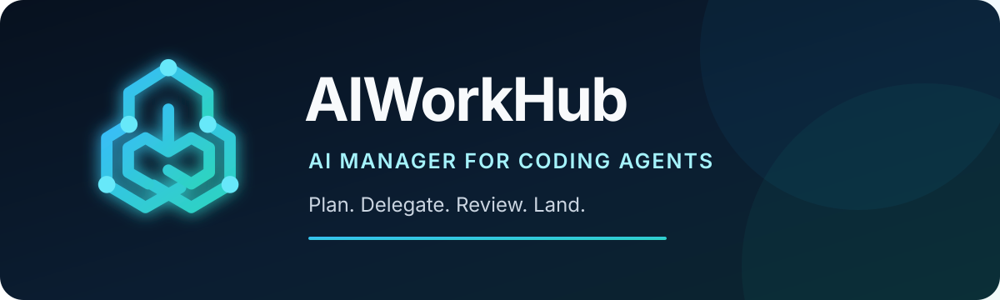
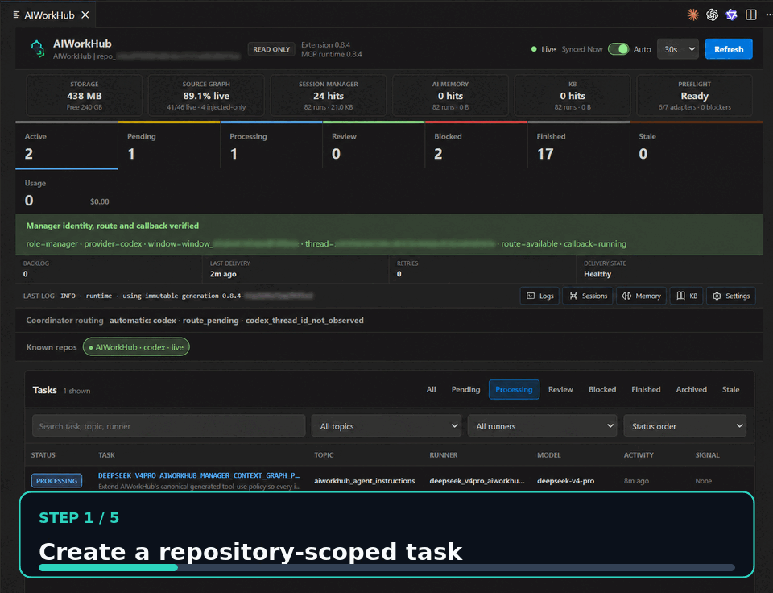
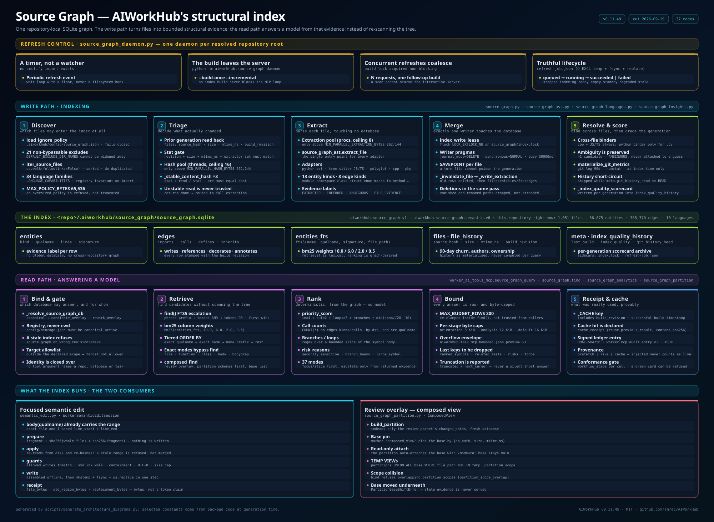
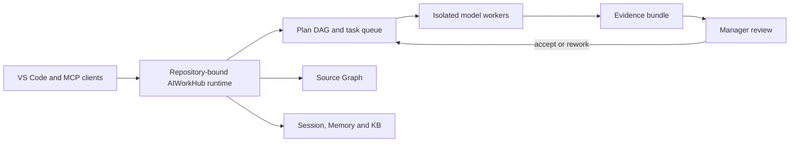

# AIWorkHub

<div align="center">
  
</div>

<p align="center">
  <strong>An AI manager that runs Claude Code, Codex and Copilot as its workers.</strong><br>
  It splits a large project into work cards, sends each card to the cheapest model that can do it, reviews every change against tests before it lands in your tree — and it is building AIWorkHub itself.
</p>

**Proof, from this repository's own history:**

- 1,984 commits since 2026-07-20, written through its own task loop
- 347 work cards accepted into its own tree
- 651 times a worker's change was sent back with code-level findings
- 621 independent reviewer passes
- 620 test files, about 262k lines of Python

**What makes it different:**

- Semantic edit: workers change hash-verified line ranges, never rewrite whole files.
- Review loop: mechanical gates and tests run first, then an independent reviewer reads the code; the manager accepts, returns with findings, or blocks — the same turn.

<p align="center">
  <a href="https://github.com/shrec/AIWorkHub/actions/workflows/ci.yml"></a>
  <a href="https://shrec.github.io/AIWorkHub/"></a>
  <a href="https://github.com/shrec/AIWorkHub/releases"></a>
  <a href="LICENSE"></a>
  
  
  <a href="https://glama.ai/mcp/servers/shrec/AIWorkHub"></a>
</p>

<p align="center">
  <a href="https://glama.ai/mcp/servers/shrec/AIWorkHub"></a>
</p>

<!-- mcp-name: io.github.shrec/aiworkhub -->



## Quick start: VS Code

1. Install from the
   [VS Code Marketplace](https://marketplace.visualstudio.com/items?itemName=IvaneChkheidze.aiworkhub)
   or download the VSIX from the latest
   [GitHub release](https://github.com/shrec/AIWorkHub/releases) and run
   `code --install-extension ./aiworkhub-<version>.vsix`.
2. Open a Git repository and run **AIWorkHub: Open Dashboard**.
3. Choose **Initialize AIWorkHub** once. Initialization is explicit and
   idempotent: it creates `.aiworkhub/`, starts the first Source Graph index and
   keeps it fresh. The extension runs on Linux, macOS, native Windows, WSL and
   the Remote-SSH workspace host.
4. Open a **new** Codex, Claude or other MCP-capable chat **after** initializing
   (or upgrading) AIWorkHub. The new chat performs tool discovery, finds the
   repository MCP tools and receives the MCP Manager Contract banner. Claude
   Code also reads the repository-local `.mcp.json` registration and
   AIWorkHub-managed `CLAUDE.md` block: direct Claude chats must bootstrap as
   managers and use Source Graph before broad built-in file discovery. They
   are not worker sessions.

The prompt below is a portable first-run diagnostic for clients that do not
automatically honor repository instructions; it is not required in a correctly
initialized new Claude Code chat:

```text
Use AIWorkHub as the manager for the currently bound repository.
First call aiworkhub_manager_bootstrap, then verify repository identity,
manager route, callback health, Source Graph readiness and model preflight.
Recover relevant Session Manager state and make one bounded AI Memory query.
Do not edit files, create tasks or launch workers yet. Report what is ready,
what is degraded, and which repository you are authorized to manage.
```

The response should identify the same repository shown in the dashboard and
report `role=manager` with a verified route. If it reports an unverified role,
the wrong repository, no tools, or a stale runtime version, stop and use
**AIWorkHub: Restart MCP Connection** or open a fresh chat. Do not ask the
model to bypass the route or write directly to `.aiworkhub` databases.

Now describe the outcome in ordinary language. A useful second prompt is:

```text
Plan this outcome with AIWorkHub: <describe the change and constraints>.
Inspect the repository with Source Graph, create bounded dependency-aware
task cards with exact acceptance criteria, allowed writes and validation,
then launch every independent non-colliding ready task in parallel on the
best available models. Keep dependent or overlapping work pending. When a
callback arrives, independently review evidence and accept or reject it.
Give me a short progress report after each accepted wave.
```

You do not need to name a model. Preflight and Workforce expose the models
already authorized in the editor, and the manager chooses a route from live
readiness and observed outcomes. Name a model only when you intentionally want
to override automatic routing.

### Understand the task lifecycle

| State/action | Meaning | Owner |
| --- | --- | --- |
| `task_create → pending` | A durable card exists; no model is running yet | Manager |
| claim + launch → `processing` | The exact dependency-ready card was claimed and its worker process started | AIWorkHub runtime |
| `review_ready` | Worker stopped and submitted diff/tests/logs/artifacts/tool receipts | Worker |
| callback | Wakes the repository's current verified manager; it is not approval | AIWorkHub callback bridge |
| accept or reject | Promote verified work, or preserve evidence and issue exact residual work | Manager |

Never move a card to `processing` merely because it is pending, and never
infer completion from chat prose. The canonical task receipt is state truth.
All review and terminal categories are callback-eligible. If a connection
drops after a write, reconcile the same task ID; identical retries are
idempotent, while inventing a replacement ID creates duplicate work.

### First task workflow

1. Confirm **Preflight** is ready and lists at least one editor model or
   authenticated CLI route. Optional/redundant unavailable routes do not block
   the repository.
2. Ask the manager chat for a bounded task. The canonical card records the
   objective, acceptance criteria, dependencies, write scope and validation.
3. Launch the exact card. The worker uses repository-local Source Graph and
   durable context inside an isolated task workspace.
4. Follow **Live Output** or wait for the durable terminal callback.
5. In **Review**, inspect the diff, tests, logs, artifacts and tool receipts.
   Accept to promote the verified change, or reject with exact residual work.

For ongoing work, ask the manager: `Inspect the completion inbox, finalize all
review-ready tasks from verified evidence, rebase the task DAG, and launch the
next dependency-safe parallel wave.` Workers never finalize their own work.

The dashboard's **Operations** dialog explains real tool use, Source Graph
modes, model outcomes, latency, token/cost evidence, callback delivery and
storage retention. See the [complete user guide](docs/GETTING_STARTED.md) for
multi-repository, Remote-SSH and troubleshooting flows.

**Current public channels:** VS Code Marketplace and signed-by-checksum GitHub
Release artifacts (VSIX, wheel and source distribution). Marketplace review
can briefly lag a new GitHub tag; the release page and attached `SHA256SUMS`
remain the exact artifact authority. Open VSX and PyPI jobs remain opt-in; see
[Publishing](docs/PUBLISHING.md) for owner setup.

## Quick start: any MCP client

AIWorkHub speaks MCP over stdio, so any MCP client can run it against a
repository.

**Option A: uvx.** Add the server to your client's MCP configuration (until the PyPI package is published, use the release wheel: `"args": ["--from", "/path/to/aiworkhub-<version>-py3-none-any.whl", "aiworkhub"]`):

```json
{
  "mcpServers": {
    "aiworkhub": {
      "command": "uvx",
      "args": ["aiworkhub"],
      "env": {
        "AIWORKHUB_REPO_ROOT": "/path/to/your/repo"
      }
    }
  }
}
```

**Option B: Docker.** Build the image from an AIWorkHub checkout, then run it
from the repository you want managed:

```bash
docker build -t aiworkhub-mcp .
docker run -i --rm -v "$PWD:/workspace/repo" aiworkhub-mcp
```

The image defaults to `AIWORKHUB_REPO_ROOT=/workspace/repo` with writes and
launches off. See [Configuration](#configuration) to change either.

## Features

- **Use models as a portfolio.** Keep frontier models for difficult judgment,
  route bounded throughput to lower-cost capable models, and use deterministic
  tools where no model is needed.
- **Delegate safely.** Dependency-aware tasks run in bounded workspaces with
  explicit write scopes, timeouts and cancellation.
- **Review evidence, not claims.** Diffs, tests, tool-use receipts, artifacts
  and approval history travel with every task.
- **Keep repositories isolated.** Every repository owns its `.aiworkhub/`
  state, callbacks, indexes, memories and audit trail.

AIWorkHub is an open-source control plane for multi-model AI coding agents.
Codex, Claude, Copilot, DeepSeek and GLM are not products it tries to replace;
they are execution routes in its workforce. It supplies the repository-scoped
planning, context, isolation, evidence, review and economics layer that lets
expensive and economical models work together as one system.

| Area | Current capability |
| --- | --- |
| Tasks | Dependency DAG, collision checks, isolated workers, truthful terminal states and manager review |
| Context | Repository-scoped Session Manager, AI Memory and KB read/write MCP tools |
| Quality | Deterministic verification, combined-tree validation, diff-scoped multi-language Known Bug Scanner, truth-preserving SARIF 2.1.0 export and configurable evidence gates |
| Operations | KPI charts, Review Inbox, callbacks, live output, authenticated all-tool telemetry, bounded logs, reversible task/archive retention and workforce scoring |
| Platforms | Linux, Windows, macOS and Remote-SSH release qualification |

The KPI view separates explicit manager decisions from worker terminal outcomes
and plots only bounded repository evidence. Its larger aggregate-only history
shows Source Graph modes, workflow stages, latency, inter-call gaps, returned
structural evidence, index generations, tool-use cohorts, deterministic
raw-path-versus-delivered-bundle byte economics, authenticated receipt
conformance, repeated-query discipline, compact-replay bytes and imported
runtime coverage. The repository also ships registry-driven retrieval
precision, eval-artifact truth, per-test suite profiling, risk precision,
no-net-growth and matched A/B instruments. This is structural evidence, not a
token multiplier. Every rate carries its sample window or denominator; token
savings and causal quality gains are deliberately not inferred. Inter-call gaps
at or above the bounded 15-minute informational threshold are surfaced, but
never mislabeled as proof that a model was inactive.

The canonical combined review surface is `aiworkhub_completion_inbox`. Tool
availability and write authority are reported by the live MCP runtime; clients
should discover the schema rather than copy a frozen tool list from docs.

### Archive and storage lifecycle

AIWorkHub does not require repositories to keep task history forever. The
Storage view can preview archived tasks older than 30, 90, 180 or 365 days,
move an exact digest-bound batch into repository-local quarantine, restore it
during a seven-day undo window, and separately purge expired quarantine
payloads. Tasks with undelivered callbacks are protected, active/review tasks
cannot enter this cleanup path, and a compact audit record survives payload
purge. Individual completed tasks can also be archived or restored from the
task detail view.

Retention defaults are repository-local and configurable in Settings. Preview
never mutates data; quarantine and permanent purge require separate explicit
confirmation.

### Three layers of model economics

| Lever | What AIWorkHub changes | User benefit | Current evidence boundary |
| --- | --- | --- | --- |
| **Token efficiency** | Source Graph discovery, bounded reads, focused context and replacement-only semantic edits | Less avoidable input and code-generation output on eligible work | 31,998 file bytes versus 531 replacement bytes is a verified 60.26× code-output shape ratio; total provider-token multiplier remains unmeasured |
| **Model-mix efficiency** | Routes bounded throughput to lower-cost capable models and reserves premium models for hard judgment or review | The same useful workload can consume fewer expensive-model tokens even when total tokens are unchanged | In one 36-run Claude cohort, Opus was 19% of tokens but 42.9% of known cost; quality-adjusted cross-model savings are the next required measurement |
| **Attempt efficiency** | Separates launch, validation, timeout and review failures so residual work can be repaired instead of blindly repeated | Fewer expensive retries and clearer reasons for rework | 47 of 114 historical attempts were retries and used 88.31M tokens; this locates the opportunity but does not claim every retry was avoidable |

These levers compound: reducing a task's unnecessary tokens and then running the
remaining bounded work on a cheaper capable model can lower cost more than
either optimization alone. Every saving still has to preserve validation and
manager-accepted quality; a cheap failed run is not an economic success.

### Where AIWorkHub sits

| Layer | Examples | Relationship to AIWorkHub |
| --- | --- | --- |
| **Repository control plane** | AIWorkHub | Owns task truth, dependencies, routing, context authorities, isolation, evidence, callbacks, review and economics telemetry |
| **Supported execution workforce** | Codex, Claude, Copilot-hosted models, DeepSeek, GLM | Models and agent runtimes AIWorkHub coordinates; they are not competitors |
| **Adjacent context/edit tooling** | Graphify, Serena and similar graph or semantic toolkits | Complementary ideas/capabilities; they do not provide the same complete repository control loop |
| **Standalone coding-agent products** | Aider, Cline and similar clients | Alternative execution experiences, not the same product layer |
| **Actual alternative today** | Manual multi-chat coordination or custom in-house glue | The workflow AIWorkHub replaces: copy/paste context, hand-managed worktrees, retries and review state |

### Source intelligence and durable context

<div align="center">
  <a href="site/assets/aiworkhub-source-graph-architecture.svg"></a>
</div>

AIWorkHub has two graphs with different authority. They are complementary, not
alternate names for the same feature.

| Surface | What it represents | Who uses it |
| --- | --- | --- |
| **Source Graph** | An automatically refreshed structural index with 34 configurable code/data/documentation families and exactly 37 bounded query modes, including exact-target `file`, `function`, `class`, `body`, `bodygrep` and `deps` modes, used to return repository context instead of repeatedly scanning the tree | Managers and workers |
| **Manager Context Graph** | An opt-in, append-only ledger and deterministic graph of manager conversation evidence across repository, thread, session and task identities | Verified managers only |

The Manager Context Graph can search an earlier decision, recover the exact
bounded transcript range around it and follow deterministic relations to its
thread, session or task. It does not replace Session Manager (current state and
handoffs), AI Memory (durable lessons), KB (curated project knowledge), or the
Source Graph (code intelligence). Current passive capture supports completed
Codex user/assistant messages; reasoning, streaming deltas, tool output,
commands and approvals are excluded. Claude and Copilot capture adapters are
not yet claimed as shipped.

For existing-file changes, the worker can stay on a focused path end to end.
Source Graph `body` returns one bounded symbol with exact line evidence; the
model emits only replacement code; AIWorkHub's local Python applier verifies the
complete-file preimage, the prepared fragment, write scope and range before
changing the isolated worktree. Full-file output remains available only as a
legacy fallback or for genuinely new files. Receipts report file, fragment and
replacement bytes, but do not turn those byte counts into an invented token
savings multiplier. Text-only and native VS Code LM providers can submit these
fragments one at a time; the local bridge validates hashes and overlaps, retains
no workspace mutation during staging and assembles the final response offline.

AIWorkHub reports context evidence rather than making an unverifiable savings
claim: requested/delivered bytes, acknowledged tool receipts, truncation and
degraded reasons remain distinguishable. See the
[Source Graph guide](docs/SOURCE_GRAPH.md),
[Manager Context Graph](docs/CONTEXT_GRAPH.md) and
[Source Graph economics](docs/PRODUCT_ROADMAP.md#p1--source-graph-economics-and-enforcement-080)
for the contract.

### Measured benefits and limits

The checked-in benchmark ledgers are recomputed in CI and include favorable,
negative and still-unmeasured results. Missing populations are shown as
`not_configured`, `inconclusive` or `unknown`; they never become zero or a
synthetic savings multiplier.

| Evidence | Current observation | Status |
| --- | --- | --- |
| Focused-edit paired pilot | Historical capped A/B observation: 27.5% fewer total tokens, 24.9% fewer output tokens and 21.5% less elapsed time across two pairs, but pair 1 used mismatched `20k`/`200k` token ceilings | Not eligible for a causal or product-savings claim; uncapped matched rerun required |
| Authenticated edit shape | 531 replacement bytes for 31,998 existing-file bytes (1.66%; 60.26× structural ratio), with zero old bytes re-emitted | Verified reduction in emitted code payload when a full-file baseline applies; not a 60.26× claim for the complete provider bill |
| Current Source Graph gate | 7/7 gated tasks used live graph evidence; 13 calls, 0 failures; p50 15.024 ms | Verified runtime snapshot |
| Callback durability | 271 events, zero dead letters and zero backlog | Verified runtime snapshot |
| Context Bundle v2 encoding | One same-evidence representative fixture shrank from 849 to 600 bytes (29.329%) | Verified structural fix; live fleet remeasurement pending |

See [Benchmarks](docs/BENCHMARKS.md) for the full evidence matrix, denominators, adjacent-tool capability
boundaries, raw ledgers and the promotion gate required before publishing any universal savings claim.

### Supported models

AIWorkHub routes by runner family and adapter. Editor routes use models already
visible in VS Code; CLI routes reuse that CLI's own authenticated session.
AIWorkHub does not copy editor or CLI credentials.

| Runner family | Supported route | Install requirement | Credential |
| --- | --- | --- | --- |
| `codex_*` | `codex_cli` or VS Code LM | Codex CLI/extension, or a VS Code LM provider | Existing Codex login, or one-time VS Code model consent |
| `claude_*` | `claude_cli` or VS Code LM | Claude Code CLI/extension, or a VS Code LM provider | Existing Claude subscription login, or one-time VS Code model consent |
| `deepseek_*` | DeepSeek V4 Pro/Flash through VS Code LM; Copilot CLI BYOK fallback | DeepSeek-capable VS Code provider; fallback requires GitHub Copilot CLI | VS Code model consent; fallback uses `aiworkhub-deepseek-credential set` |
| `glm_*` | GLM 5.3 through VS Code LM; Copilot CLI BYOK fallback | GLM 5.3 visible in VS Code; fallback requires GitHub Copilot CLI | VS Code model consent; fallback uses `python -m aiworkhub.glm_credentials setup` |
| `copilot_*` | Public VS Code Language Model API | GitHub Copilot extension | GitHub sign-in and one-time model consent |

Exact model availability is discovered at runtime because subscriptions and
editor model catalogs differ. The editor broker starts automatically, performs
credential-free discovery and asks for consent only when an exact queued task
first invokes that model. In Remote-SSH, the workspace extension uses VS Code's
Language Model API to consume the model catalog exposed by the client window; it
does not look for a second provider credential on the SSH host. The dashboard
keeps models visible in the editor separate from execution routes.

## Configuration

The MCP server reads these environment variables. Writes and launches are off
unless you turn them on.

| Variable | Default | Purpose |
| --- | --- | --- |
| `AIWORKHUB_REPO_ROOT` | Unset: the nearest `.aiworkhub/project.json` above the working directory within its Git repository, else that Git root | Repository the server binds to; when set it takes precedence over the working directory |
| `AIWORKHUB_ALLOW_WRITES` | `0` | Only the exact value `1` enables write tools |
| `AIWORKHUB_ALLOW_LAUNCH` | `0` | Only the exact value `1` enables worker launches, and launches also need `AIWORKHUB_ALLOW_WRITES=1` |
| `AIWORKHUB_MAX_PROCESSES` | `4` | Cap on workers running at once; values below 1 become 1 and values above 32 become 32 |
| `AIWORKHUB_PROVIDER_LAUNCH_LIMITS` | `opencode-go=1` | Per-provider launch limits as `provider=limit` pairs, for example `opencode-go=1,xai=2`; listed providers override the default entry by entry |

Enable writes and launches only in a trusted manager process. Launched workers
never inherit the manager launch capability.

## How it works



The MCP server uses stdio only. Writes and process launches are independently
disabled by default. Credentials stay outside the repository, callback events
are durable and repository state remains local.

The full block diagram and the Observe → Decide → Delegate → Verify → Promote → Learn loop: [The whole system](docs/ARCHITECTURE.md#the-whole-system).

## What's new in 0.12.76

- 0.12.76 is a hotfix for Claude Code chats on 0.12.75: a chat whose MCP server runs under the stable launcher's supervisor keeps its Claude manager seat again, so card creation and semantic edit no longer fail with `manager_identity_required` while bootstrap reports a verified manager.
- Carried from 0.12.75: Codex is one manager provider among several (one provider registry, no silent fallback to Codex, accept records the verified manager); reviewers work on C++ candidates and on changes that delete files, Source Graph indexes MSBuild project files, and `forbidden` bounds writes only.
- The full release history is in [CHANGELOG.md](CHANGELOG.md).

## Continuous Audit as a Service (CAAS)

**CAAS** stands for **Continuous Audit as a Service** — AIWorkHub audits its own
repositories continuously, as a service of the normal lifecycle rather than a
step someone remembers to run. The canonical protocol is
[docs/CAAS_PROTOCOL.md](docs/CAAS_PROTOCOL.md). `aiworkhub.caas_enforcement`
checks the protocol's automatically-enforceable properties on every guarded
lifecycle transition, so a repository cannot drift out of compliance silently;
`aiworkhub.audit_system` runs read-only, narrow-scope review passes that emit
structured findings into NeedFix with provenance.

> **Naming correction.** The expansion "Continuous Automated Assurance System"
> is wrong; the owner-canonical expansion is **Continuous Audit as a Service**.
> That incorrect wording lives in the separate **UltrafastSecp256k1** README and
> cannot be fixed from this repository — it must be corrected in that repository.

## Security

- stdio transport; no AIWorkHub HTTP listener unless the opt-in WorkHub Mail
  listener is started on a host and port you name;
- separate `AIWORKHUB_ALLOW_WRITES` and `AIWORKHUB_ALLOW_LAUNCH` gates, both
  off by default;
- shell-free exact-task process launch and bounded workspaces;
- owner-only credentials outside repositories and secret-redacted logs;
- append-only audit evidence and authenticated tool-use receipts;
- fail-closed repository, manager, task and claim-episode identity checks.

Read [SECURITY.md](SECURITY.md) before enabling autonomous launches. Callback
delivery and its optional Codex compatibility transport are documented in
[Callback delivery](docs/CALLBACKS.md).

## Development

```bash
python -m pip install -e ".[dev]"
ruff check src/aiworkhub scripts tests
mypy
python -m pytest -q
npm --prefix vscode-extension install
npm --prefix vscode-extension test
```

From a clone, `pip install -e .` and
`AIWORKHUB_REPO_ROOT=/path/to/repository python -m aiworkhub.server` run the
same stdio MCP runtime. Contributions follow the
[Contributing Guide](CONTRIBUTING.md).

## Links

- [Product site](https://shrec.github.io/AIWorkHub/)
- [Getting Started](docs/GETTING_STARTED.md)
- [Architecture](docs/ARCHITECTURE.md)
- [Changelog](CHANGELOG.md)
- [Contributing](CONTRIBUTING.md)
- [Security policy](SECURITY.md)
- [Product Roadmap](docs/PRODUCT_ROADMAP.md), [Publishing Guide](docs/PUBLISHING.md)
  and [Brand Guide](docs/BRAND.md)

## Acknowledgements

Thanks to [null0xxx](https://github.com/null0xxx) for sharing
[kimi-atlas](https://github.com/null0xxx/kimi-atlas) and useful ideas about
multi-agent orchestration and evidence-driven verification.

AIWorkHub is open source under the [MIT License](LICENSE).
