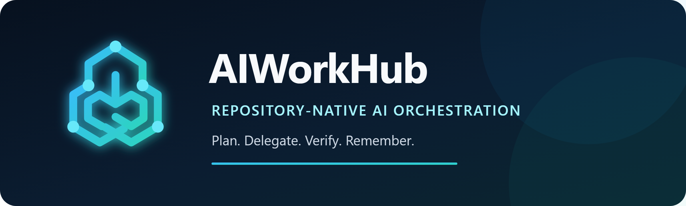
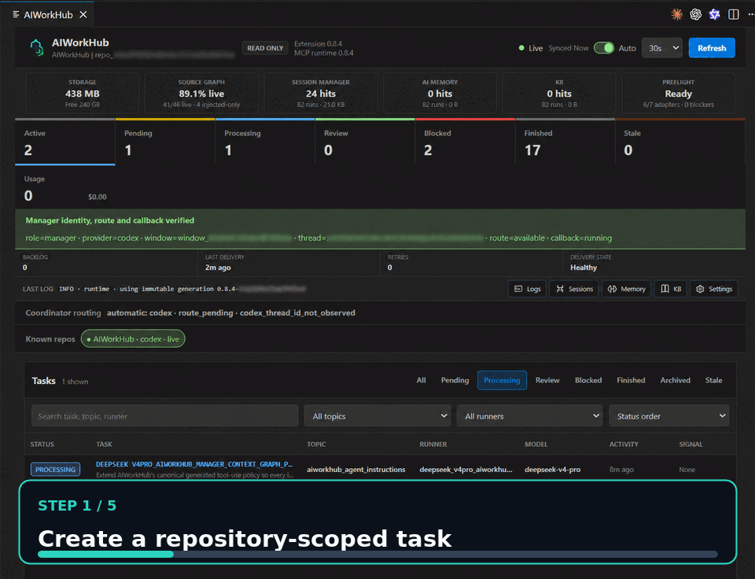
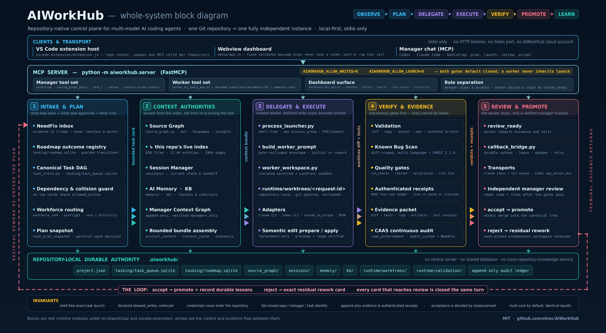
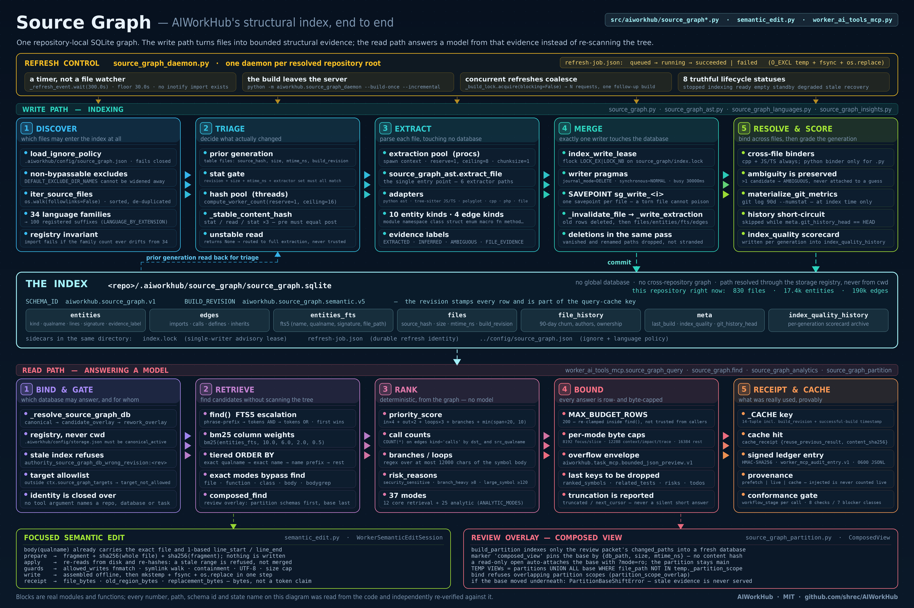
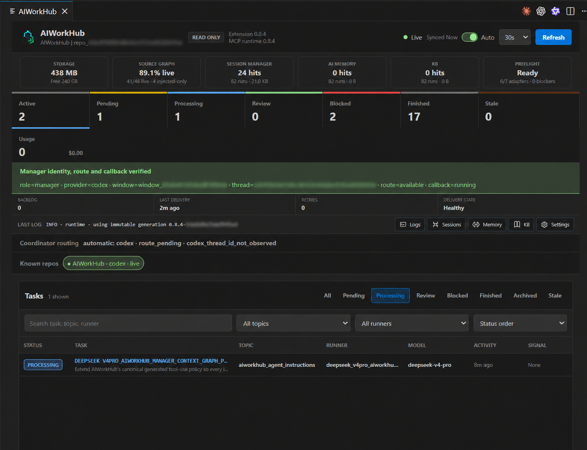

<div align="center">
  
</div>

# AIWorkHub for VS Code

**One manager AI routes work to worker AIs through task cards, independent review and measured acceptance.**

<div align="center">
  
  <br>
  <em>Create a bounded task, launch a model worker, inspect its evidence and accept or rework it.</em>
</div>

## What AIWorkHub is

AIWorkHub is a VS Code extension and MCP server. You talk to one **manager** AI.
It splits your goal into **task cards** and hands each card to a **worker** AI
(Codex, Claude, Copilot-hosted models, DeepSeek, GLM and others). Nothing lands
in your tree until independent review and measured validation accept it.

The extension opens as a retained editor tab and runs one repository-scoped MCP
stdio runtime on the workspace host. It needs no AIWorkHub cloud account, binds
no port and exposes no LAN service unless you start the opt-in WorkHub Mail
listener on a host and port you name.

## How it works

1. **Card.** The manager writes a bounded card: objective, acceptance criteria,
   dependencies, allowed writes and validation.
2. **Isolated worker worktree.** A worker runs the exact card in its own
   worktree with repository-scoped Source Graph, Session, Memory and KB context.
3. **Validation gates.** Mechanical checks and the card's declared tests run
   first.
4. **Reviewer lenses.** Independent correctness, security and code-quality
   reviewers read the candidate; one aggregate decision packet reaches the
   manager. Review automation never accepts or rejects on its own.
5. **Accept or reject.** The manager promotes verified work, or rejects it with
   exact residual work.
6. **NeedFix ledger.** Findings are tracked as NeedFix records until a verified
   fix resolves them.

### Review automation

Automatic quality-review launch moves worker completion through a
system-owned correctness, security, and code-quality chain without
prematurely waking the manager. After every required lens passes, one
authenticated aggregate binds the candidate and reviewer evidence and emits
exactly one manager callback. Review automation never accepts or rejects the
implementation target; the verified manager receives only the completed
decision packet. Legacy review receipts remain compatible without blocking
later chains.

### Architecture at a glance

<div align="center">
  
  <br>
  <em>The complete AIWorkHub control plane, execution, evidence and improvement loop.</em>
</div>

<div align="center">
  
  <br>
  <em>Incremental Source Graph refresh, index, query, semantic-edit and review-overlay paths.</em>
</div>

## Highlights

- **Multi-provider workforce routing.** Cards go to models by cost and observed
  outcome, not by habit.
- **Source Graph.** A repository-local code index (including Dart) covering
  exactly 34 language/file families, with
  exactly 37 currently exposed bounded Source Graph query modes.
  Workers change hash-verified line ranges through semantic edit instead of
  rewriting whole files.
- **Sandboxed workers.** Worker processes run in a Windows AppContainer or a
  Linux Landlock sandbox with explicit write scopes.
- **NeedFix on the dashboard.** Records are grouped by work state.
- **Callback loop.** A durable callback wakes the verified manager chat when a
  worker reaches review. A callback is a wake-up, not an approval.
- **Release cut.** One ordered, fail-fast run takes a release from checks to a
  tagged build.

### Operational dashboard

The retained dashboard combines the task DAG, live worker output, Review
Inbox, callback health, model readiness, NeedFix records grouped by work state,
Source Graph coverage and bounded viewers for logs, sessions, AI Memory and KB.

<div align="center">
  
  <br>
  <em>Tasks, callback health, source coverage, context stores, preflight and evidence in one retained editor tab.</em>
</div>

## What's new in 0.12.97

- Finished NeedFix records leave the active list: a manager-verified fix resolves in one call from any open status with its evidence inline, and the staleness sweep checks every open record, not only new ones.
- A card that names an active NeedFix in its title or objective must declare it on a `Resolves:` or `Refs:` line, so work that fixes a record can no longer bypass the ledger.

## Get started

1. Install from the Marketplace (or install a release VSIX) and open a Git
   repository in VS Code.
2. Run **AIWorkHub: Open Dashboard**. In a multi-root workspace, select the
   repository first.
3. Choose **Initialize AIWorkHub** once. Initialization is explicit and
   idempotent; it creates state only under `.aiworkhub/` and starts the first
   Source Graph index in the background.
4. Open a **new** Codex, Claude or MCP-capable chat afterwards so it discovers
   the runtime tools. For Claude Code, initialization also maintains the
   repository-local `.mcp.json` registration and the AIWorkHub block in
   `CLAUDE.md`.
5. For automatic callbacks use the built-in Manager chat (any backend) or
   Claude Code. A Codex sidebar chat is inbox-only and polls the review queue
   itself; see
   [Callback delivery](https://github.com/shrec/AIWorkHub/blob/main/docs/CALLBACKS.md#manager-transports).
6. Describe the outcome you want. The manager creates cards and launches
   independent, dependency-ready work; inspect the result in **Review** and
   accept or reject it.

### Run your first task

Start a new chat after initialization or upgrade and paste:

```text
Use AIWorkHub as manager for the currently bound repository. Call
aiworkhub_manager_bootstrap first; verify repository identity, manager route,
callback, Source Graph and preflight. Do not edit or launch yet. Report what is
ready and what is degraded.
```

Then describe the outcome normally. Creating a task leaves it `pending`; exact
claim plus launch makes it `processing`; workers stop at `review_ready`;
callbacks wake the current verified manager; and only that manager accepts or
rejects verified evidence.

### Commands

- **AIWorkHub: Open Dashboard** — open or reveal the retained editor tab.
- **AIWorkHub: Select Repository** — bind the dashboard in a multi-root window.
- **AIWorkHub: Refresh Dashboard** — refresh the current repository snapshot.
- **AIWorkHub: Restart MCP Connection** — replace only AIWorkHub's selected
  repository MCP child.

## Models and authentication

AIWorkHub does not proxy credentials. It uses models already authenticated in
the editor or CLI; Preflight reports which routes are ready in this window.

| Runner | Typical adapter | Requirement |
| --- | --- | --- |
| Codex | Codex CLI or VS Code Language Model | Existing Codex login or one-time VS Code consent |
| Claude | Claude Code CLI or VS Code Language Model | Existing Claude login or one-time VS Code consent |
| Copilot-hosted models | VS Code Language Model | GitHub sign-in and one-time model consent |
| DeepSeek | VS Code Language Model or Copilot CLI fallback | Provider visible in VS Code, or its own stored credential |
| GLM 5.3 | VS Code Language Model or Copilot CLI fallback | Provider visible in VS Code, or its own stored credential |
| Grok | Observed Kilo/Grok worker route | Existing provider login |

## Source Graph and context

Source Graph is an incrementally refreshed structural repository index, not a
remote Sourcegraph service. Managers and workers start with low-token `focus`
and `slice` queries and widen to calls, impact or test mapping only when the
task needs it.

Session Manager stores current state and handoffs; AI Memory stores durable
lessons; KB stores curated project facts. All are repository-local and have
bounded viewers in the dashboard.

## Requirements

- VS Code 1.93 or newer; the Python runtime is packaged with the extension.
- At least one authenticated model route (see above).
- Linux, macOS, native Windows, WSL and Remote-SSH.
- **Remote development:** AIWorkHub is a workspace extension. In Remote-SSH,
  install it on the remote extension host; its packaged Python runtime, MCP
  child and repository state run beside the remote checkout. No port
  forwarding is required.

## If the dashboard is not ready

- **Connecting:** run **AIWorkHub: Restart MCP Connection** once and check the
  last-log row.
- **A model is unavailable:** open Preflight and grant the one-time model
  consent when prompted.
- **Source Graph is empty:** initialize the repository and run a refresh.
- **A chat cannot see tools:** open a new chat after installation or upgrade.

## Trust and privacy

- Local stdio transport; no AIWorkHub network listener.
- Read-only and launch-disabled by default.
- Repository-specific state, route identity and audit trail.
- No AIWorkHub telemetry upload of prompts, source, credentials or memories.

## Documentation

[Getting Started](https://github.com/shrec/AIWorkHub/blob/main/docs/GETTING_STARTED.md) ·
[Architecture](https://github.com/shrec/AIWorkHub/blob/main/docs/ARCHITECTURE.md) ·
[Source Graph](https://github.com/shrec/AIWorkHub/blob/main/docs/SOURCE_GRAPH.md) ·
[Security Policy](https://github.com/shrec/AIWorkHub/blob/main/SECURITY.md) ·
[Changelog](https://github.com/shrec/AIWorkHub/blob/main/vscode-extension/CHANGELOG.md)

AIWorkHub is open source under the
[MIT License](https://github.com/shrec/AIWorkHub/blob/main/LICENSE).
